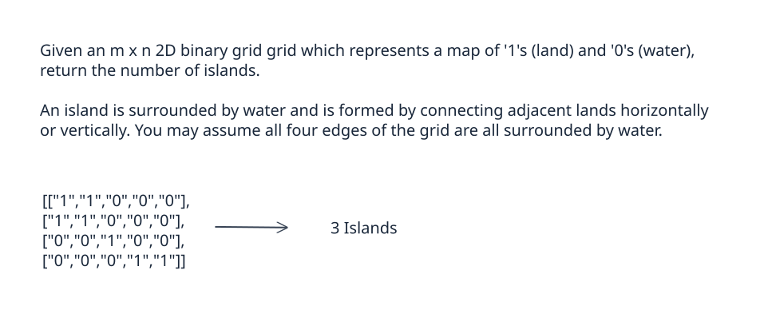

# Count islands

Original whiteboard (anonymized export).

The board works a grid example with three four-connected islands. It records the answer and the drawing, without a saved traversal implementation.

