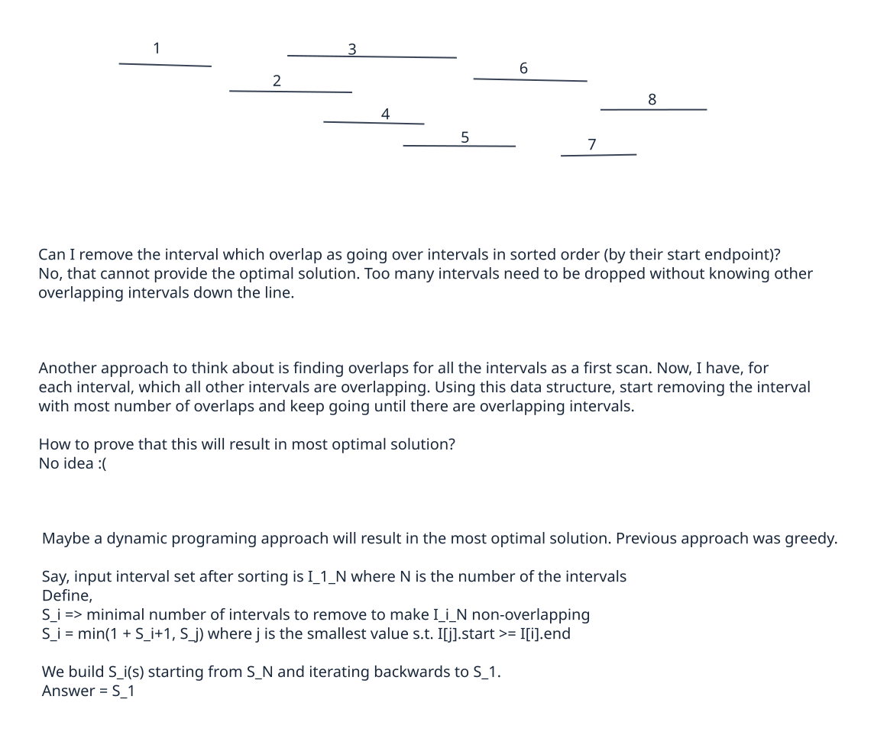

# Remove overlapping intervals

Original whiteboard (anonymized export).

The board explores deletion heuristics and a suffix DP. Its written keep branch skips conflicting intervals without charging those deletions, so the recorded recurrence is incomplete.

