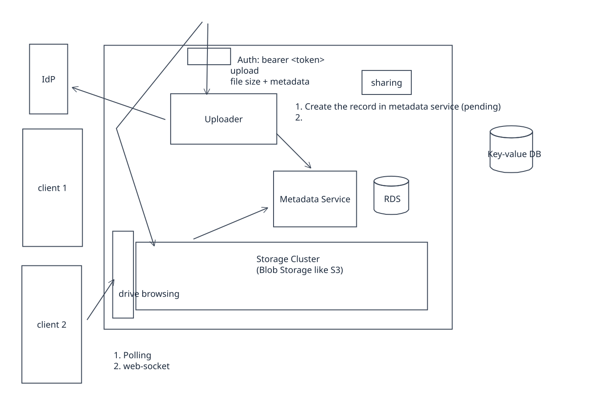

# Document sharing and sync

Original whiteboard (anonymized export).

The uploader creates pending metadata and stores file bytes separately. The board shows identity-provider integration and compares polling with WebSockets for client sync.

