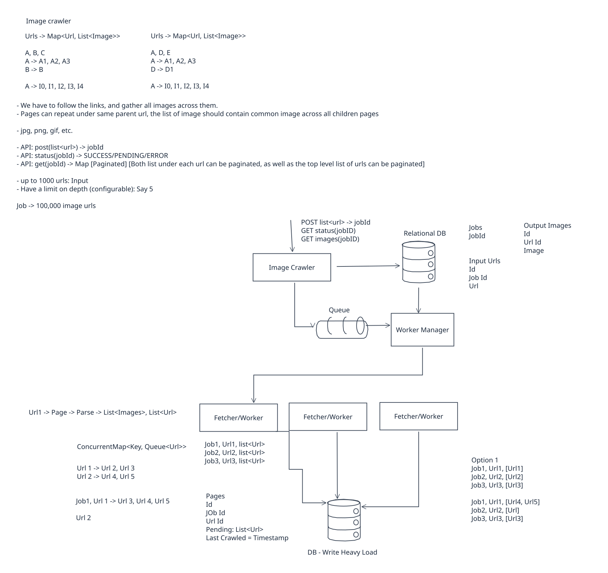
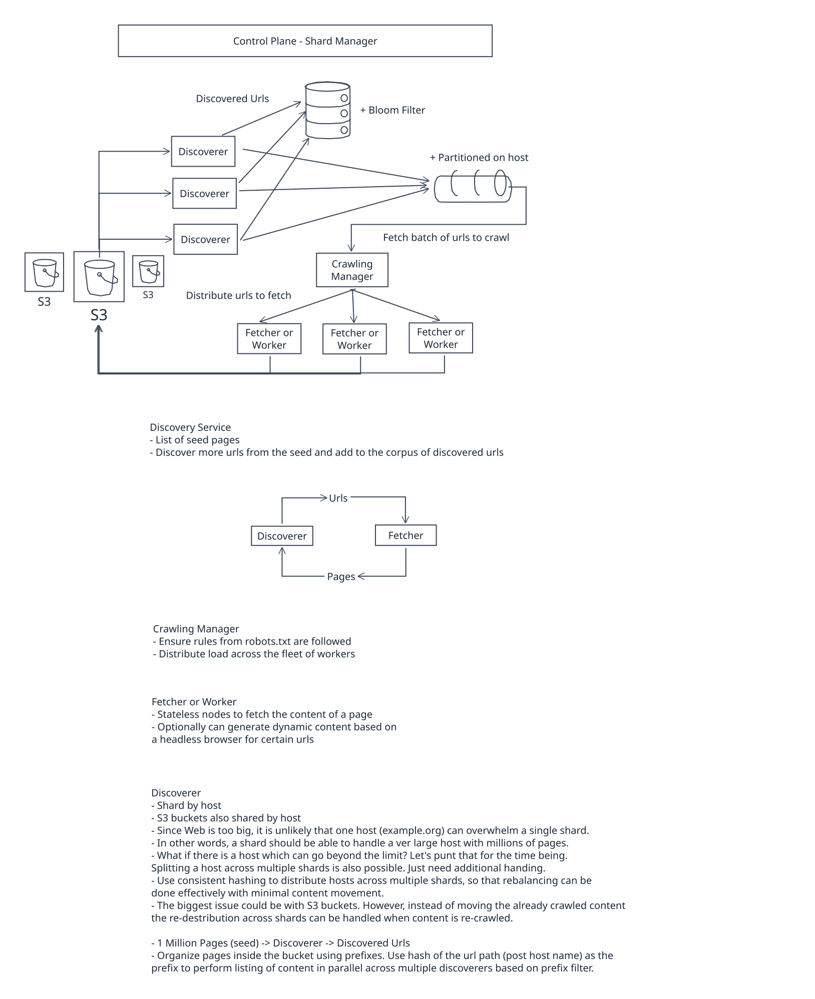

# Image web crawler

Original whiteboard (anonymized export).

Submit seeds as a job, track pending URLs and associate each discovered image with its input URL. The second board explores host-based sharding and the crawl frontier.

