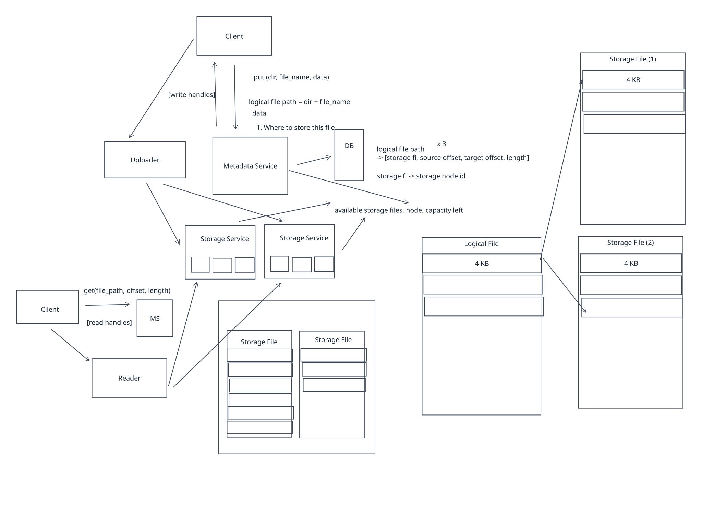

# Lakehouse file storage

Original whiteboard (anonymized export).

The metadata service maps a logical path to storage-file extents, then to storage nodes. Clients obtain read or write handles and transfer bytes to the storage service.

