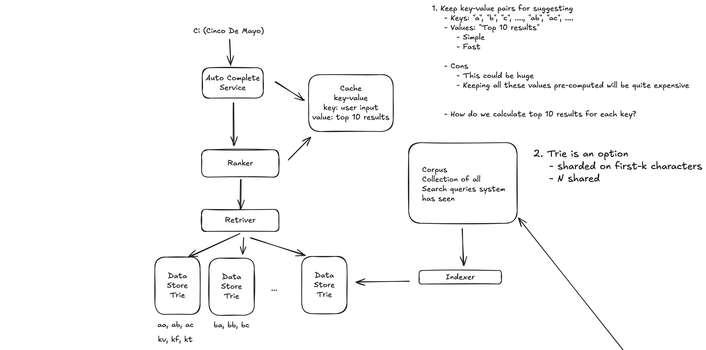

# Search autocomplete

Original architecture sketch (anonymized crop).

The service targets ten suggestions within 200 ms. The diagram weighs the memory and update cost of storing every prefix against a trie sharded on its first characters.

