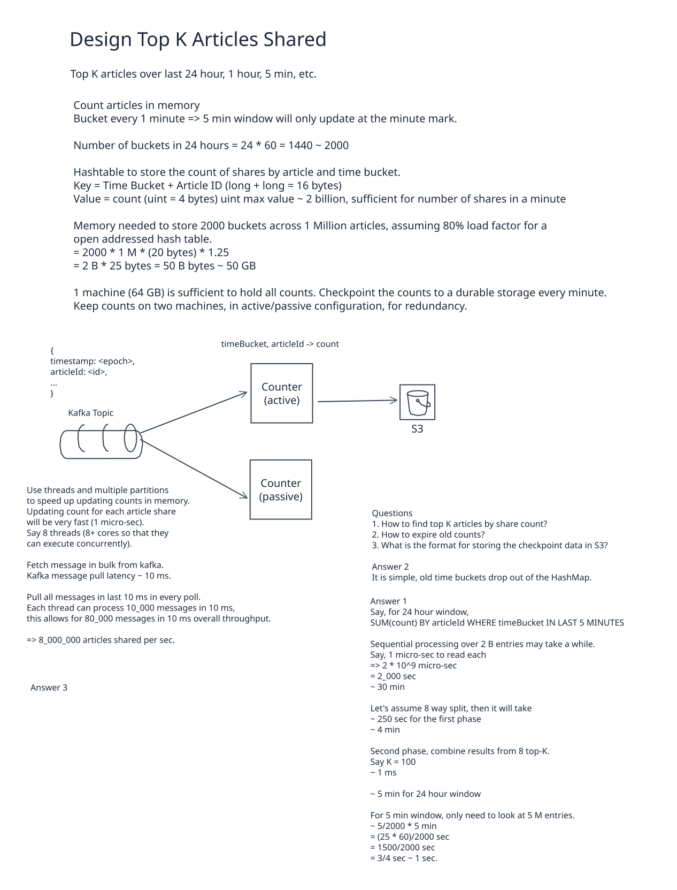

# Top shared articles

Original whiteboard (anonymized export).

Bucket shares by article and minute in memory, checkpoint each minute and retain an active/passive pair. The board estimates the time to compute and merge partial top-k results.

