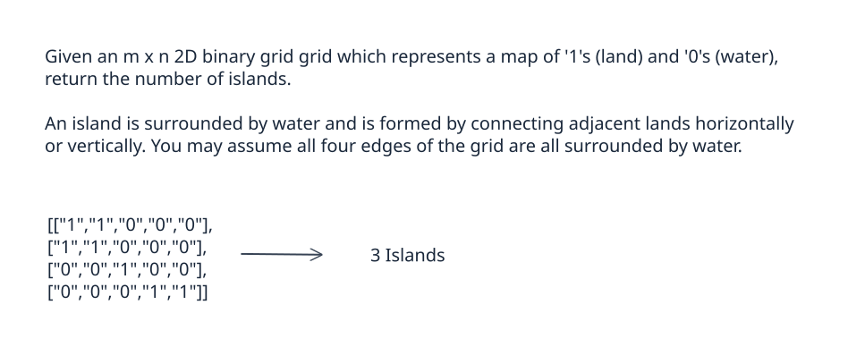

# Count islands

## Problem

Given a rectangular grid of land and water, count connected land components. Two land cells connect through a shared horizontal or vertical edge; a shared corner is insufficient.

## Example

In the original grid a four-cell block occupies the upper left. A lone center cell touches the next cluster only diagonally, and a pair at the bottom right shares an edge. The recorded answer is three islands.

## Recorded approach

The board works a grid example with three four-connected islands. It records the answer and the drawing, without a saved traversal implementation.

[Original whiteboard (anonymized export)](../../../sources/notes/coding/count-islands.md)
