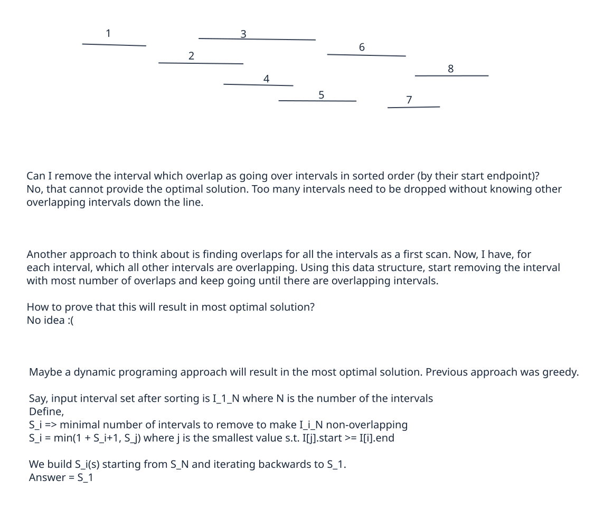

# Remove overlapping intervals

## Problem

Remove the fewest intervals so that every remaining pair is compatible. Two intervals that meet at an endpoint may both remain.

## Example

With [1,4), [1,2), [2,3) and [3,4), dropping the long interval preserves three others. Keeping the long interval and jumping to the first later compatible start silently skips three deletions unless the recurrence accounts for them.

## Recorded approach

The board explores deletion heuristics and a suffix DP. Its written keep branch skips conflicting intervals without charging those deletions, so the recorded recurrence is incomplete.

[Original whiteboard (anonymized export)](../../../sources/notes/coding/remove-overlapping-intervals.md)
