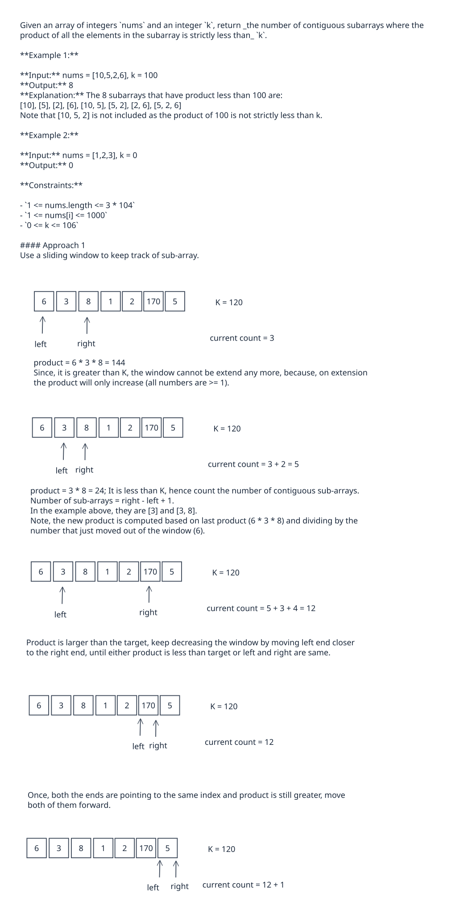

# Subarray product below threshold

## Problem

Count contiguous subarrays of positive integers whose product is strictly below k. Positivity is what lets the left edge move in only one direction.

## Example

For [10,5,2,6] and k=100, the valid subarrays ending at each position contribute 1, 2, 2 and 3. The product 10×5×2 equals the threshold and must be excluded.

## Recorded approach

The board traces a sliding window, dividing out the leftmost factor when extending the window would exceed the threshold.

[Original whiteboard (anonymized export)](../../../sources/notes/coding/subarray-product-below-threshold.md)
