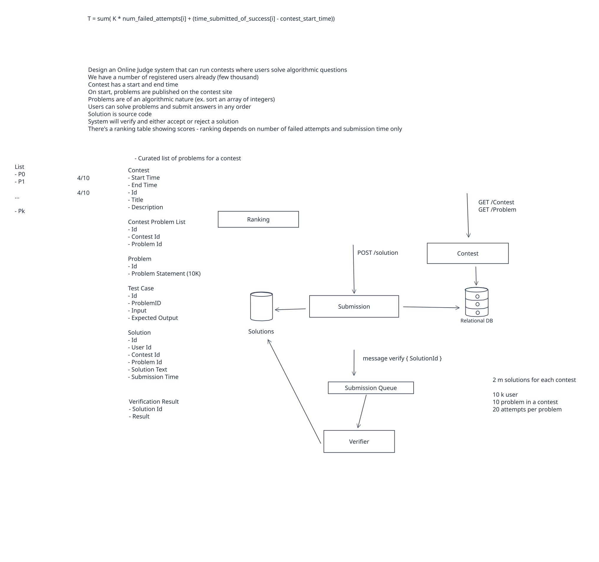

# Contest judging service

## Problem

Publish timed contest problems, accept code submissions, execute the appropriate test cases and rank contestants using accepted answers, submission times and failed attempts.

## Example

Two contestants submit before close, but the later submission finishes judging first. Standings need the submission timestamp as well as the verdict.

## Recorded approach

The board models contest problems, test cases and timestamped submissions. A submission queue feeds verification, whose result is associated with the submitted solution.

[Original whiteboard (anonymized export)](../../../sources/notes/designs/contest-judging-service.md)
