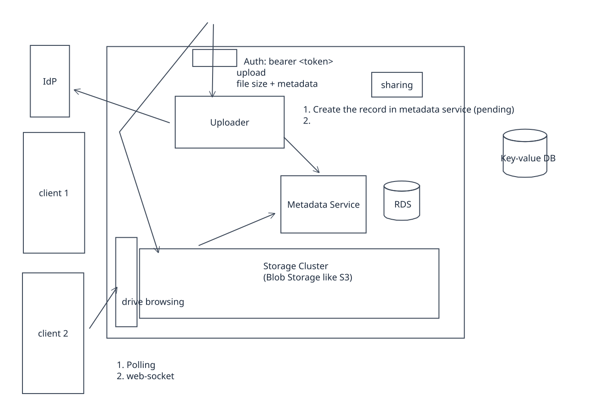

# Document sharing and sync

## Problem

Share binary files with users and groups, support read and comment permissions, and synchronize metadata across devices with lazy download.

## Example

One device uploads the last part of a file while another browses the folder. A pending upload must be distinguishable from a file whose contents are ready.

## Recorded approach

The uploader creates pending metadata and stores file bytes separately. The board shows identity-provider integration and compares polling with WebSockets for client sync.

[Original whiteboard (anonymized export)](../../../sources/notes/designs/document-sharing-and-sync.md)
