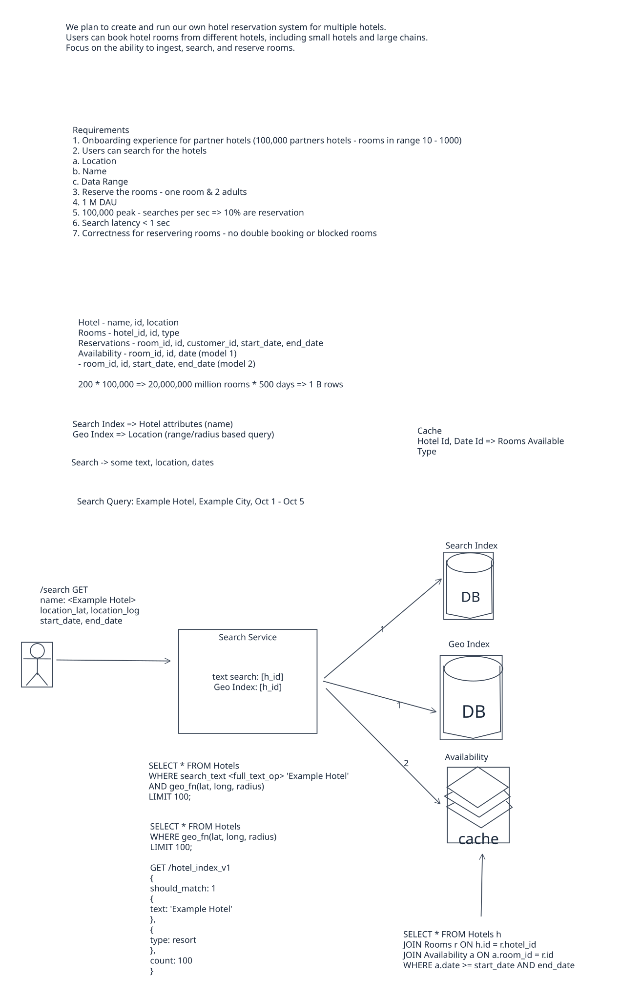

# Hotel reservation portal

## Problem

Ingest room availability from multiple hotels, support searches by name, location and date, and reserve one room for a continuous stay.

## Example

A room is available on Friday and Sunday but occupied Saturday. It cannot satisfy a Friday-through-Sunday stay even if a cached search result still lists the hotel.

## Recorded approach

Use text and geographic indexes to find hotels, then query room availability for the stay. The board compares room-night records with date ranges and sketches the search queries.

[Original whiteboard (anonymized export)](../../../sources/notes/designs/hotel-reservation-portal.md)
