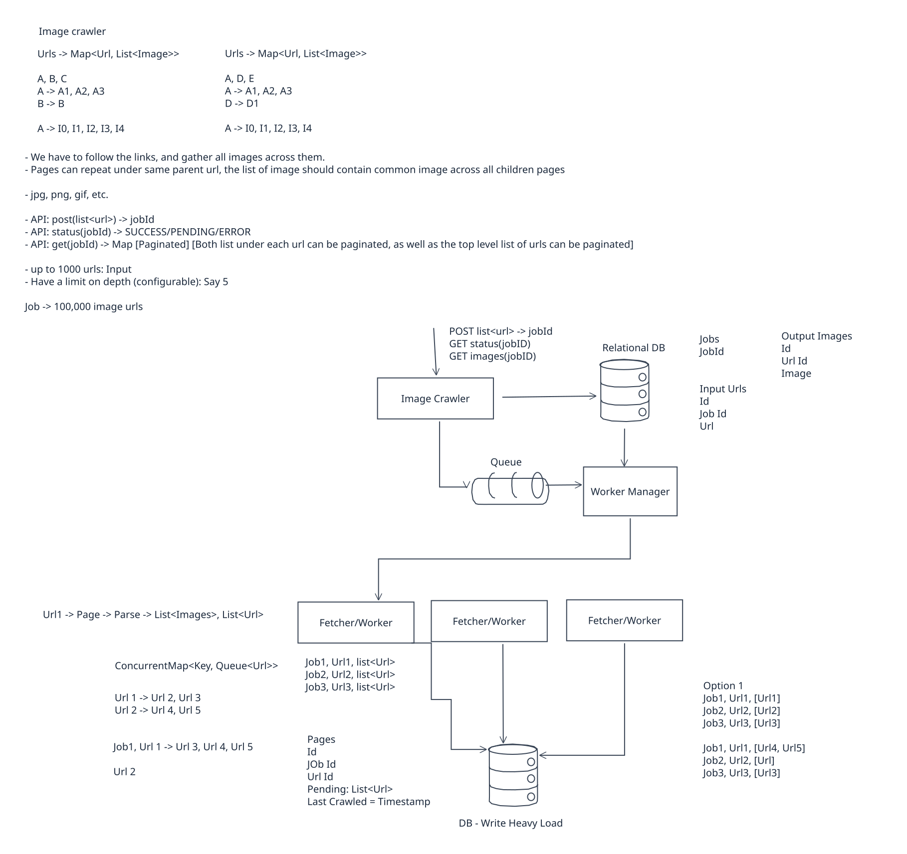
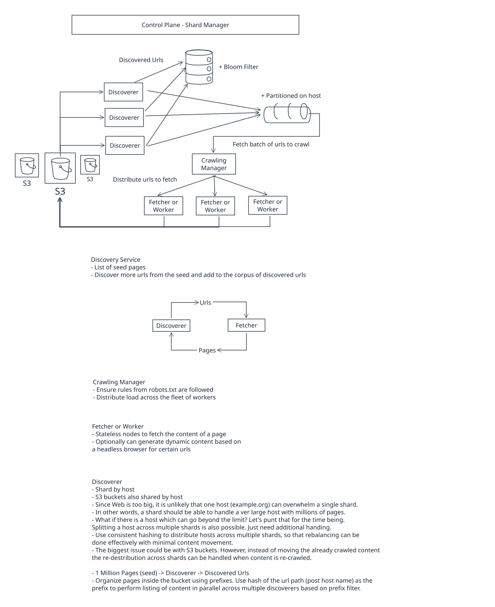

# Image web crawler

## Problem

Accept a list of seed URLs as an asynchronous job. Follow links to a bounded depth and return paginated image results for each seed.

## Example

Two seeds point to the same gallery. Fetching the gallery once saves work, but both seeds must still receive the images reachable through it.

## Recorded approach

Submit seeds as a job, track pending URLs and associate each discovered image with its input URL. The second board explores host-based sharding and the crawl frontier.

[Original whiteboard (anonymized export)](../../../sources/notes/designs/image-web-crawler.md)

## Retrospective study notes

### Key Ideas
- A web crawler's core challenge is **work distribution without redundancy** — dividing URLs across a fleet so no worker starves, none is overloaded, and no URL is fetched twice.
- The system decomposes into: Discovery (finding URLs), Management (distributing/scheduling work), Fetching (stateless workers), and Storage (dedup + results).
- Consistent hashing by host is the partitioning strategy — assigns host ownership to shards, enabling per-host politeness enforcement and localized DNS caching.
- Bloom filters prevent duplicate URL fetches across the distributed fleet.
- Async job-based API (POST → jobId, GET status, GET results) decouples crawl submission from completion — suits long-running crawls with paginated output.
- Depth-limiting and configurable constraints bound the crawl scope (e.g., max 1000 input URLs, depth 5, producing ~100K results).

### My Understanding
- Both designs (practice and interview) solve the same fundamental problem: distributing crawl work across workers while avoiding redundant fetches and ensuring steady progress.
- The practice design emphasizes infrastructure: sharding by host via consistent hashing, S3 storage partitioned by host, bloom filters for dedup, a Control Plane/Shard Manager for rebalancing, and stateless fetchers with optional headless browser support.
- The interview design emphasizes API interfaces and component interaction: a job-based async API, a Worker Manager distributing from a Queue to Fetcher nodes, a relational DB tracking jobs/URLs/images/pages, and handling write-heavy load.
- These two approaches converge — the Worker Manager needs consistent hashing internally to distribute queue work to workers, and the practice design also uses queues (partitioned by host) distributed through a Crawling Manager. Same ideas, different presentation angles.
- The hardest part is ensuring no worker starves or is overloaded — the system must make progress at a steady, optimal pace across the fleet.
- At the crux: work distribution while avoiding redundant work. No duplicate fetches, shared DNS cache, maximize resource utilization (memory and CPU).

### Open Questions
- **Politeness/rate limiting per domain across distributed workers** — how to enforce crawl-delay and robots.txt limits when multiple workers might target the same domain? Consistent hashing helps (host affinity) but what about rebalancing transitions?
- **URL priority and freshness** — how to decide re-crawl order? Priority queues per host? Freshness signals? How does this interact with depth-limiting?
- **Failure handling** — what happens when a worker dies mid-crawl? Need idempotent fetch operations, checkpointing of discovered-but-not-yet-fetched URLs, and lease-based task ownership with timeouts.

### Connections
- Relates to: [consistent hashing](../../theory/consistent-hashing.md) — core partitioning strategy for host-to-shard assignment
- Relates to: [bloom filters](../../theory/bloom-filters.md) — probabilistic dedup of URLs across distributed fleet
- Relates to: [work distribution](../../system-design-concepts/work-distribution.md) — the central challenge of crawler design

### Key Quotes / Annotations
From practice design (Web Crawler.excalidraw.md):
> "Discoverer — Shard by host. S3 buckets also shared by host. Since Web is too big, it is unlikely that one host (wikipedia.com) can overwhelm a single shard."
> "Use consistent hashing to distribute hosts across multiple shards, so that rebalancing can be done effectively with minimal content movement."

From the interview design:
> "API: post(list<url>) -> jobId; status(jobId) -> SUCCESS/PENDING/ERROR; get(jobId) -> Map [Paginated]"
> "DB - Write Heavy Load"
> "ConcurrentMap<Key, Queue<Url>>"

## Retrospective study notes

A scaling-focused self-interview on the web-crawler problem (the API/job-interface version is [image web crawler](image-web-crawler.md)), this time **deliberately skipping the API/job-interface layer** to spend the whole round on the crawl-scaling crux: how one worker sustains ~1k docs/s on I/O-bound work, and how the fleet dedups + stays resilient at 10k–100k docs/s.

### Key Ideas

- **The crux is I/O-bound throughput.** "10k docs/s ≠ 10k machines, because a fetcher is almost never on-CPU — it's parked on network I/O." Hand the socket to the kernel, let an **event loop** drive thousands of in-flight fetches, and offload the CPU-bound parse to a **separate thread pool** so it never blocks the loop.
- **Connection reuse falls out of host co-location, not connection count.** "1k docs/s does *not* mean 1k open sockets." If work is partitioned so one worker owns a set of **hosts**, its fetches concentrate on few servers → the kernel **reuses TCP connections**, and **HTTP/2 multiplexes** many requests per connection (no repeated handshake). The next failure is HTTP/2 **head-of-line blocking** (one slow response stalls the shared connection), and the fix is **QUIC/HTTP-3** (independent streams, no transport-level HOL).
- **The dual-write seam.** "Put the new URLs in the Redis seen-set, *then* push them to the Kafka queue" **loses work on crash**: mark-seen succeeds, worker dies before enqueue → the URL is now permanently deduped-away but never queued → **silently never crawled.** Fix: **reverse the order** — enqueue first, then mark seen — and only **commit the Kafka input offset after** both the content is durably stored *and* the child URLs are enqueued. At-least-once + idempotent dedup then makes a crash replay safe (worst case: re-fetch, not lose).
- **"Batch SADD is atomic" hides a membership gap and a cross-slot problem.** Two issues with relying on Redis to serialize concurrent workers this way: (1) A single `SADD key m1 m2 m3` is atomic, but it returns only a *count* of new elements, not *which* were new — so you can't tell which URLs to enqueue. You need **per-URL novelty** (did *this* URL transition unseen→seen?). (2) In a **sharded** Redis, the members of one batch hash to **different slots/shards**, so there is no single atomic multi-key op across them. Fix: **N per-key check-and-adds** (`SADD key one-url`, or a small Lua script), pipelined; each returns 0/1, and **1 = novel = the enqueue signal**. This makes the enqueue-then-mark ordering per-URL exact.
- **The authoritative seen-set doesn't fit in RAM at web scale.** Billions of URLs × tens of bytes ≫ economical Redis memory (multi-TB). The scaling answer is the classic two-tier: a **Bloom filter** (or per-shard RocksDB/SSD-backed set) as the cheap in-front membership check, backed by an authoritative on-disk set; Redis holds only hot/recent keys. Redis as the whole seen-set is fine at small scope, but the web-scale version must name the memory wall. (The Bloom-filter box in the API-layer design is exactly this in-front tier.)
- **Partitioning coherence.** Sharding **Redis/dedup by URL** conflicts with the throughput argument, which needs **host co-location** for connection reuse — and politeness needs it too. Two different partition keys pulling against each other. **Unify on host**: partition the frontier, the dedup, *and* the fetch assignment all by **host** (via [consistent hashing](../../theory/consistent-hashing.md)). Then connection reuse, DNS-cache locality, **and** per-host politeness/rate-limiting all fall out **for free** from the same decision — one partition key buys three properties.
- **Carry units: bytes vs bits.** 1000 docs/s × 10 KB = 10 **MB**/s = **80 Mbps**, not 10 Mbps, and a 50-server rack is ~**4 Gbps**, not 500 Mbps. The conclusion (well under a 10–25 Gbps NIC) holds either way, but write the unit next to every number (KB→Kb is ×8) and sanity-check the magnitude.
- **Kafka is a log, not a drainable delay-queue; recrawl needs a scheduler.** A tiered-topic idea (real-time / daily / weekly topics) conflates two things: **priority classes** (legit — separate topics/consumer pools so a slow bulk tier can't starve real-time) and **time-delayed scheduling** (not what a log does — you can't "crawl this again next Tuesday" by parking it in a Kafka partition). Recrawl wants a **scheduler**: a **Redis sorted set / DB keyed by `next_crawl_time`**, a due-poller that enqueues when a URL comes due, and cadence set by observed change-rate. Pair with **conditional GET** (`ETag` / `If-Modified-Since`) and a **content hash** to skip unchanged pages cheaply.
- **Why BFS.** "We must download a page before we can see its links" is a true premise (fetch-before-expand), but it argues for neither BFS *nor* DFS — both expand only discovered frontier nodes. The real reason to prefer **BFS** is **politeness and freshness**: breadth spreads load across hosts and reaches high-value shallow pages first, whereas DFS tunnels deep into one host (rude, and starves breadth).

### My Understanding

- The naive "one thread per fetch, so 10k machines" estimate is wrong because fetching is I/O-bound, and the connection count stays low through host co-location → TCP reuse → HTTP/2 multiplexing, with HTTP/2 HOL → QUIC as the next failure and its fix.
- **Run the crash-in-between check on every pair of writes.** Any time two stores must both happen (mark-seen + enqueue; store-content + commit-offset), ask "what if the process dies between them?" and order them so the *recoverable* failure (re-do work) is the only one possible — never the *unrecoverable* one (lose work).
- **When a batch op returns a count, ask what you actually needed — the count or the identities.** `SADD`'s new-element *count* isn't the *which*. If downstream action depends on per-item novelty, you need per-item ops. Same for any "atomic batch" that spans shards — atomicity is per-key, not per-batch.
- **Make the partition key earn multiple properties before you pick it.** List everything that wants locality (dedup, connection reuse, politeness, storage) and pick the key that serves the most. Host does; URL doesn't.
- **Separate priority from scheduling.** "Some things are more urgent" → priority classes (separate queues/pools). "Crawl this again later" → a time-indexed scheduler (`next_crawl_time` sorted set), not a parked log message.

### Open Questions

- **Per-host politeness across a distributed fleet:** with host-based partitioning, per-host `crawl-delay` is a *local* token bucket at the owning worker — but how does rebalancing (a host moving shards) hand off the rate-limit state without a burst that violates politeness during the transition?
- **Frontier prioritization:** beyond recrawl cadence, how are *new* URLs prioritized (page importance / PageRank-ish, depth, freshness) so the real-time tier isn't just FIFO? Where does the priority score live and who computes it?
- **The authoritative seen-set at web scale:** concretely, Bloom-in-front-of-RocksDB per host-shard vs. a shared store — what's the false-positive budget (a Bloom FP means a real page is *never* crawled), and how is the filter rebuilt/scaled as the corpus grows?
- **Recrawl mechanism end-to-end:** sorted-set-by-`next_crawl_time` + due-poller + conditional GET (`ETag`/`If-Modified-Since`) + content-hash-to-skip — how do these compose, and how is cadence adapted from observed change-rate per URL?
- **Exactly-once-ish storage:** if a worker stores content to S3, then crashes before committing the Kafka offset, replay re-fetches and re-stores — is the object keyed by URL (idempotent overwrite) or is there a dedup on content hash to avoid duplicate objects?

### Connections

- Builds on: [image web crawler](image-web-crawler.md) — the API/job-interface version of the same problem; this one goes inside the scaling crux. Enriches [web crawler](../../system-design-concepts/web-crawler.md).
- Central challenge: [work distribution](../../system-design-concepts/work-distribution.md) — crawling is work-distribution-without-redundancy; the host-vs-URL partition-key choice is the crux of *that* pattern too.
- Partition mechanism: [consistent hashing](../../theory/consistent-hashing.md) — host→shard assignment that co-locates dedup, connection reuse, and politeness.
- Web-scale dedup: [bloom filters](../../theory/bloom-filters.md) — the in-front membership tier the RAM-bound seen-set requires; note the FP-means-never-crawled hazard.
- The resilience seam is the crawler instance of: [exactly once semantics](../../system-design-concepts/exactly-once-semantics.md) — at-least-once delivery + idempotent dedup + commit-after-durable-write; and [durability rpo rto](../../theory/durability-rpo-rto.md) — the RPO-for-throughput trade and the non-idempotent-replay hazard on crash recovery.
- Queue semantics: [kafka](../../tech/kafka.md) & [the log abstraction](../../system-design-concepts/the-log-abstraction.md) — why a log is a priority/throughput substrate, not a delay-queue; recrawl needs a scheduler folded from a time index, not a parked partition.
- Single-key coordination echo: [hot key write contention](../../system-design-concepts/hot-key-write-contention.md) — the per-URL check-and-add is the "concentrate the coordination on one key" move at URL granularity.
- Networking depth: [networking deep dive](../../reading-notes/networking-deep-dive.md) — TCP handshake cost, HTTP/2 multiplexing + head-of-line blocking, QUIC/HTTP-3 streams (the connection-reuse argument).
- Async return-path family: [async response routing](../../system-design-concepts/async-response-routing.md) — the fetch→parse→store pipeline is event-loop + offloaded CPU work; the same "don't block the loop" discipline.

### Concepts flagged for wiki (pending /update-wiki)
- **I/O-bound fetch throughput** — why docs/s ≠ machines: event loop + kernel socket handoff + offloaded CPU parse; connection count stays low via host co-location → TCP reuse → HTTP/2 multiplexing; HTTP/2 HOL → QUIC. *(new pattern — candidate spinout, or a "Scaling the fetch" section on [web crawler](../../system-design-concepts/web-crawler.md))*
- **Two-store dedup/enqueue ordering seam** — mark-seen-then-enqueue loses work on crash; enqueue-then-mark + commit-offset-after-both + per-key novelty. *(extend [exactly once semantics](../../system-design-concepts/exactly-once-semantics.md) / the crawler page)*
- **One partition key, three properties** — partition by host to get dedup locality + connection reuse + per-host politeness from one decision; URL-partitioning fights connection reuse. *(extend [work distribution](../../system-design-concepts/work-distribution.md))*
- **Priority classes ≠ delayed scheduling** — separate queues for urgency vs. a `next_crawl_time` scheduler for recrawl; a log is not a delay-queue. *(extend [kafka](../../tech/kafka.md) / [the log abstraction](../../system-design-concepts/the-log-abstraction.md))*
- **Conditional GET + content-hash for recrawl** — `ETag`/`If-Modified-Since` + content hash to skip unchanged pages cheaply. *(new, small — crawler page)*
