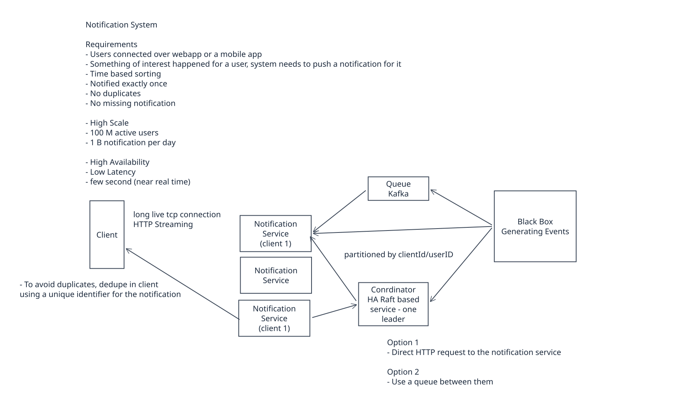
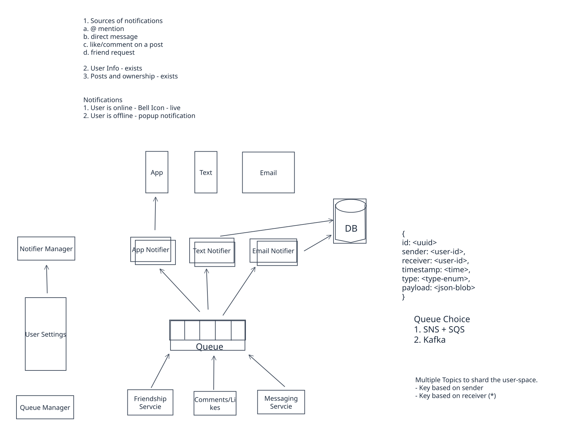

# Notification delivery

## Problem

Deliver user-targeted events across web and mobile clients with low latency, including after a disconnect. Preserve a way to recognize duplicate delivery.

## Example

A client receives a notification and disconnects before acknowledgment. Replaying the event on reconnect must not show a second copy of the same notification.

## Recorded approach

The live path uses long-lived connections, recipient-keyed queues and client-side deduplication. A separate board models email, text and in-app delivery according to user settings.

[Original whiteboard (anonymized export)](../../../sources/notes/designs/notification-delivery.md)
