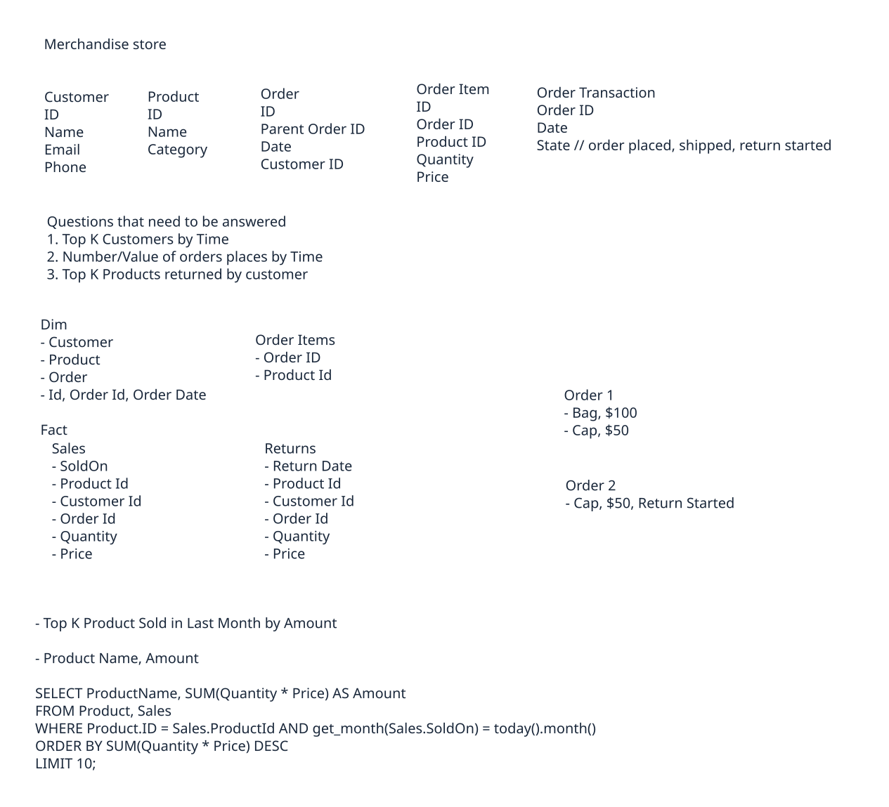

# Order and returns analytics

## Problem

Represent customers, products, order lines and returns so analysts can rank sales and returns over a selected period.

## Example

An order contains two products and one is later returned. Order count, sales value and returned quantity have different grains and cannot all be counted by counting joined rows.

## Recorded approach

The board models orders, line items, transactions and returns. Its sales query ranks products by the sum of quantity times price.

[Original whiteboard (anonymized export)](../../../sources/notes/designs/order-and-returns-analytics.md)
