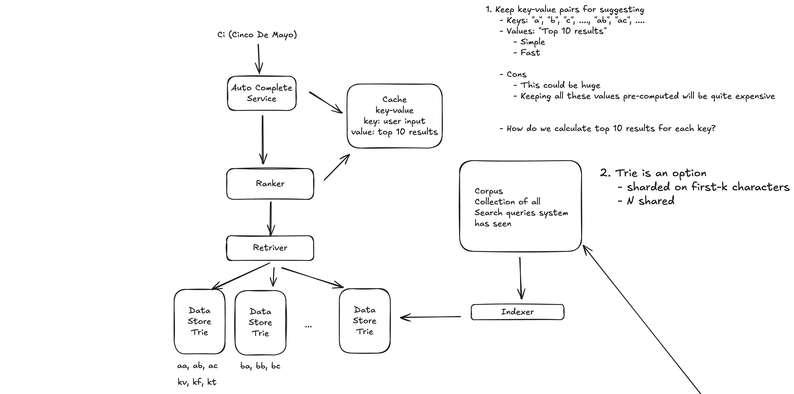

# Search autocomplete

## Problem

Refresh up to ten ranked keyword suggestions as the user types, within the interactive latency budget. Consider both popular prefixes and growth of the vocabulary.

## Example

Typing one more letter changes the prefix and its top ten. Precomputing every list is fast to read but requires storing and refreshing many overlapping prefixes.

## Recorded approach

The diagram compares precomputed top-ten results per prefix with sharded tries. A ranker and retriever sit behind the autocomplete service, and a query corpus feeds the indexer.

[Original architecture sketch (anonymized crop)](../../../sources/notes/designs/search-autocomplete.md)
