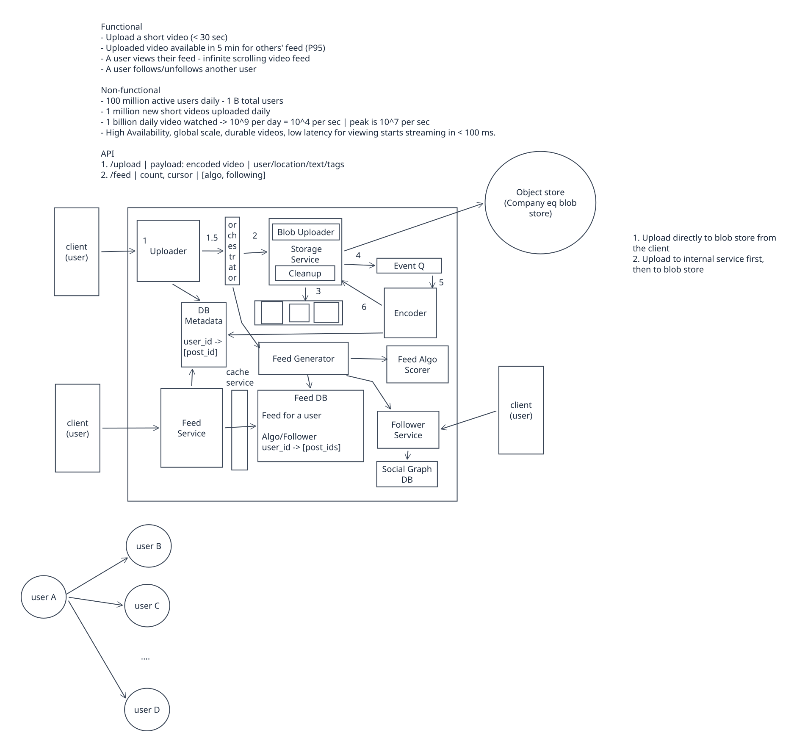

# Short video feed

## Problem

Accept short video uploads, encode playable variants and serve a personalized paginated feed. Playback latency and the delay before a new upload appears are separate concerns.

## Example

A creator publishes one video to a very large following. Encoding happens once; deciding when and how to insert the video into follower feeds dominates the fanout cost.

## Recorded approach

The board separates upload, encoding and metadata from feed generation. The feed service consumes ranked post IDs from a feed database and cache.

[Original whiteboard (anonymized export)](../../../sources/notes/designs/short-video-feed.md)

## Retrospective study notes

A **self-driven** ~60-min systems-design run at "Design YouTube Shorts": record/upload a <30s video, have it appear in others' feeds within ~5 min, infinite-scroll a feed (algo + following), follow/unfollow.

### Key Ideas

- **The 1000:1 read:write ratio is the shaping constraint.** 1M uploads/day vs 1B watches/day. It justifies every downstream choice: multi-resolution transcode (spend once at write to save 1000× at read), CDN, read-replica cache tiers.
- **Upload path: proxy-through-a-service vs presigned direct-to-blob is a real fork.** Routing bytes through an internal storage-service abstraction (own the encoding pipeline, don't couple the client to S3) is defensible, but the scale-default is the *other* branch — **presigned-URL direct-to-blob + trigger the encoder off a storage event** — which kills the double-hop bandwidth that proxying costs. Client coupling is fixable with a signed-URL indirection.
- **Materialized feed of IDs, hydrated at read.** `user_id → [post_id]` (a sorted set scored by recency for the following feed, by model score for the algo feed), one interface over both paths so features don't cost 2×. Feed stores only tiny IDs; metadata + CDN URLs are hydrated on read. Orchestrator (Temporal-style durable workflow) drives upload→encode→fan-out with checkpoint/resume.
- **The crux: fan-out can't be pure push.** Celebrity/viral upload ⇒ millions of feed writes ⇒ can't hit the 5-min SLA. Resolution = **hybrid**: fan-out-on-write for the masses, **don't** fan out hot users — stitch their posts in at read time from a per-user posts table and cache the unified feed. → [timeline fanout hybrid](../../system-design-concepts/timeline-fanout-hybrid.md).
- **The crux: cursor stability under a mutating feed.** Followers change mid-scroll ⇒ items shift/dupe/skip. Resolution = **snapshot isolation**: a snapshot ID pins a feed version, the generator won't overwrite an in-use snapshot (copy-on-write a new version), snapshots are TTL'd. → [feed cursor stability](../../system-design-concepts/feed-cursor-stability.md).
- **The hot video path is a *serving* problem, not a feed-cache problem — but there are three hot spots, not one.** The feed cache is keyed per-user, so virality spreads across the keyspace (no hot key). The real pressure lands on: **(1) video bytes → CDN** (dominant), **(2) the one viral video's metadata → hot *read* key**, **(3) its view/like counter → hot *write* key**. Only #1 is the CDN's job; #2/#3 live in the application's services and need their own treatment. → [cdn](../../tech/cdn.md), [hot key write contention](../../system-design-concepts/hot-key-write-contention.md).
- **A viral video is the CDN's best case, not worst case.** High popularity = high edge cache-hit ratio = origin barely touched. The CDN's *hard* case is the long tail of rarely-watched videos. The scary moment for a hot object is the **cold/expiry instant** (synchronized miss ⇒ origin stampede), solved by request coalescing + shield + stale-while-revalidate. → [cache stampede](../../system-design-concepts/cache-stampede.md).

### My Understanding

- The two feed insights that matter: the push/pull hybrid (treat a viral-via-algo video exactly like a celebrity — don't write it to a million feeds, stitch it at read) and the **snapshot-isolated cursor** (a mutating feed corrupts offset pagination).
- "Virality is about serving the bytes from cache, the feed cache isn't the pressure point" — and the *reason* is that the feed cache is keyed per-user, so the same viral `post_id` scatters across millions of distinct keys and never becomes a hot key. But the viral object still creates two non-CDN hot spots: the **metadata for that one `post_id` is a hot read key** (every feed hydration fetches it) and the **view counter is a hot write key** (every view increments it — the same hot-key shape as an auction's bid path). The CDN saves the bytes; it does nothing for those two. Fix: replicate/edge-cache the metadata, and shard/approximate the counter.
- The **CDN is just a distributed reverse-proxy cache + routing**, and the properties that matter fall out of that: route the user to the nearest PoP (anycast or DNS mapping), serve on HIT, on MISS go edge→regional shield→origin so origin load is O(#shields) not O(#edges). **Cache-hit ratio is mostly the origin's job, not the CDN's**: make video URLs immutable + versioned (a finished encode never changes, so TTL≈∞, no revalidation), and **segment the video (HLS/DASH)** so one 4s chunk is a single cache key shared by every viewer who reaches that point. The long tail is what tanks hit ratio; a shield + cache-admission ("cache on 2nd hit") handles it.
- **Engineer the playback SLA you assert.** The <100ms mechanism is **client prefetch** — the client already holds the next N videos' first segments before the swipe — plus **adaptive bitrate** so the player fetches a small segment, not a whole file, and picks a rendition to fit the device/network. The <100ms SLA is really a **CDN cache-hit-ratio** target, not a single-service latency; a miss costs an origin/shield RTT.
- **Pin the peak once, then make every capacity claim divide into it.** 100× of 10⁴ = 10⁶/s, and replica counts must reconcile with that one peak. On any media system, size egress/storage explicitly: bytes/video × renditions × 10⁹ watches/day *is* the CDN's justification and the dominant cost line.
- **30-second answer for "how does a viral Short stay fast?":** "It's a serving-not-feed problem — the feed cache is keyed per user so virality never makes a hot feed key. The bytes are served by the CDN, and virality is actually the CDN's easy case: high popularity means high edge hit-ratio. I make that work by giving each video an immutable, segmented URL so a 4-second chunk is one cache key shared by everyone. The real risks are the cold/expiry stampede on the hot object — handled by request coalescing + an origin shield + stale-while-revalidate — and the two non-CDN hot spots virality creates: the video's metadata becomes a hot *read* key (replicate/edge-cache it) and its view counter a hot *write* key (shard or approximate it)."

### Open Questions

- **Cold-start feed** for a brand-new user with no follows and no interaction history — what seeds the algo feed?
- **Already-seen dedup** across an infinite scroll session (and across devices) — where does the seen-set live, and how big before it's a cost?
- **Pure-pull for the following feed at low follow-counts** — with both feeds defaulted to materialization, when is query-followed-users'-recent-posts-and-merge actually cheaper than maintaining a materialized list?
- **Counter exactness vs cost** for view counts — approximate (sharded/lazy sum) is fine for display, but monetization/analytics may need exact; where's the split and the reconcile path?
- **Serving-path failure modes to design** — shield failover, CDN region outage, cache penetration by garbage keys, and the metadata hot-read-key mitigation concretely (local cache in feed service? dedicated replica set?).

### Connections

- Extends / is the feed sibling of: [message fanout](../../system-design-concepts/message-fanout.md) (real-time pub/sub fan-out) and [read side fanout](../../system-design-concepts/read-side-fanout.md) (one→many live updates) — the timeline push/pull hybrid is the *third* fan-out shape (precompute-on-write vs compute-on-read), distinct from both. → [timeline fanout hybrid](../../system-design-concepts/timeline-fanout-hybrid.md).
- Reuses: [hot key write contention](../../system-design-concepts/hot-key-write-contention.md) — the viral view-counter is the same hot-write-key crux as an auction's bid path; the viral metadata is its hot-*read* mirror.
- Builds on: [copy on write vs mvcc](../../theory/copy-on-write-vs-mvcc.md) — the snapshot-isolated cursor is COW/MVCC applied to a feed; [feed cursor stability](../../system-design-concepts/feed-cursor-stability.md) is the applied page.
- New serving machinery: [cdn](../../tech/cdn.md), [cache stampede](../../system-design-concepts/cache-stampede.md), [video delivery read path](../../system-design-concepts/video-delivery-read-path.md).
- Latency budgets: [latency numbers](../../theory/latency-numbers.md) — the two-tier read budget (feed-of-IDs vs bytes) and why prefetch beats a per-swipe fetch.
- Durability/ops echo of: [durability rpo rto](../../theory/durability-rpo-rto.md) — the cleanup-validates-before-delete + orchestrator-resume instinct on the upload path.

### Concepts flagged for wiki (done in this /update-wiki)
- **Timeline fan-out hybrid** — fan-out-on-write vs -on-read; celebrity problem; SLA forces the split. *(new)*
- **Feed cursor stability** — snapshot isolation over a mutating feed; why offset pagination corrupts. *(new)*
- **CDN** — routing, edge→shield→origin, immutability + segmentation for hit ratio, viral = best case. *(new, tech)*
- **Cache stampede / thundering herd** — coalescing, stale-while-revalidate, shield, pre-warm. *(new)*
- **Video delivery read path** — client prefetch + adaptive bitrate + segmentation as latency *and* cache lever. *(new)*
- **Hot read key** — viral object's metadata read by millions; extend [hot key write contention](../../system-design-concepts/hot-key-write-contention.md). *(extend)*
