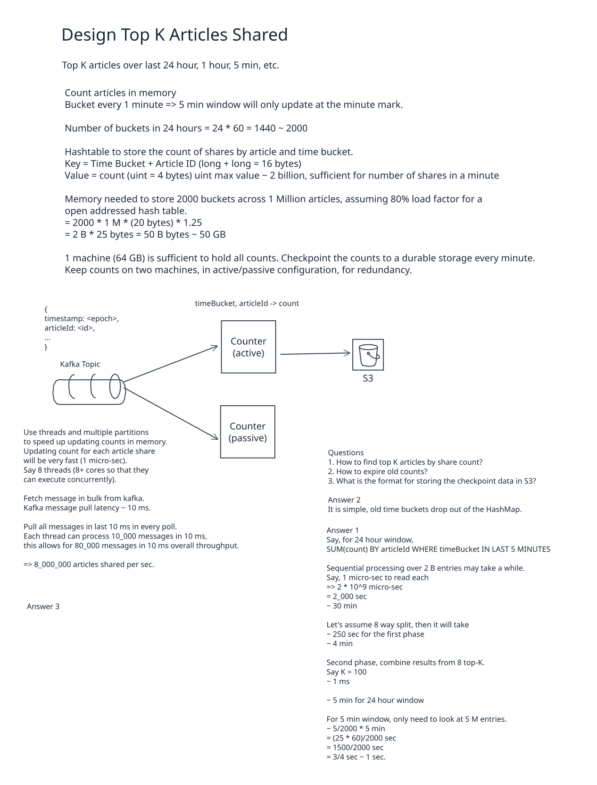

# Top shared articles

## Problem

Rank articles by shares over recent windows ranging from minutes to a day. The same stream must support each window as old shares expire.

## Example

An article popular yesterday can still lead the daily list while disappearing from the five-minute list. Per-minute counts let the windows expire different buckets.

## Recorded approach

Bucket shares by article and minute in memory, checkpoint each minute and retain an active/passive pair. The board estimates the time to compute and merge partial top-k results.

[Original whiteboard (anonymized export)](../../../sources/notes/designs/top-shared-articles.md)
